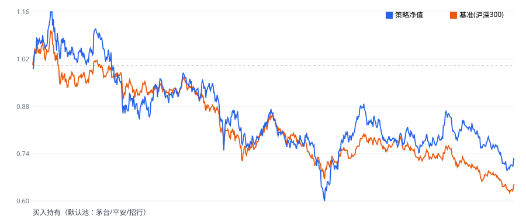
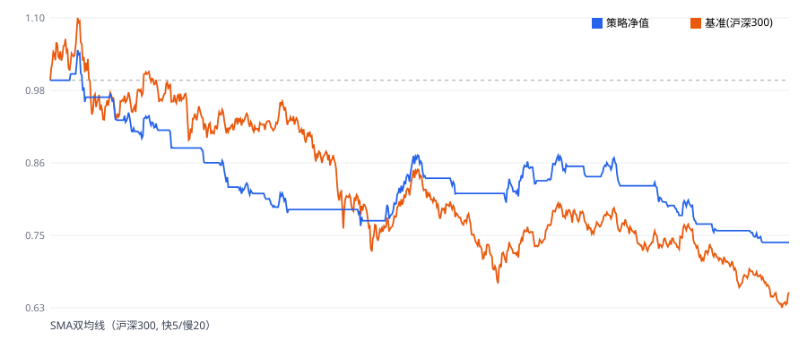
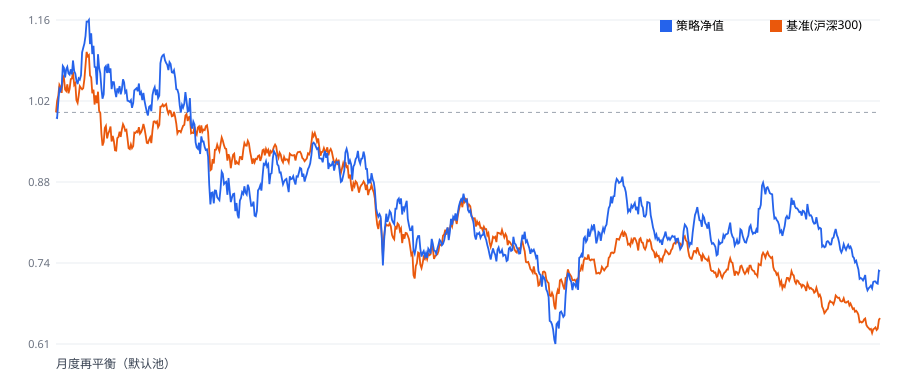

# 样例回测报告（三模板策略同区间对比）

> 数据区间：**2021-01-01 ~ 2023-12-31** ｜ 初始资金：1,000,000 元 ｜ 复权：qfq ｜ 基准：沪深300
> 说明：以下为真实历史数据回测结果（A股 2021–2023 熊市区间），所有收益已含佣金/印花税/滑点，无前瞻偏差，口径保守。

## 一、核心指标对比

| 策略 | 累计收益 | 年化收益 | 年化波动 | 夏普 | 最大回撤 | 卡玛 | 成交笔数 |
|---|---|---|---|---|---|---|---|
| 买入持有（默认池：茅台/平安/招行） | -26.92% | -10.30% | 24.86% | -0.495 | 47.99% | -0.215 | 3 |
| SMA双均线（沪深300, 快5/慢20） | -26.66% | -10.19% | 9.66% | -1.262 | 30.12% | -0.338 | 50 |
| 月度再平衡（默认池） | -26.31% | -10.04% | 24.57% | -0.490 | 47.48% | -0.211 | 111 |

## 二、净值曲线（策略 vs 基准）

### 买入持有（默认池：茅台/平安/招行）

### SMA双均线（沪深300, 快5/慢20）

### 月度再平衡（默认池）

## 三、回测假设（指标口径，详见 docs/metric_formulas.md）

- 无风险利率 rf = 2.0%（取正，拉低夏普，保守）
- 年交易日 = 252；年化 = (末/首)^(252/天数) − 1
- 佣金 0.03%（单笔最低 5.0 元）、印花税（仅卖出）0.05%、滑点 0.1%（双边）
- 成交规则：**信号于第 t 日收盘生成，成交于第 t+1 日开盘执行**（无前瞻偏差）；前复权价；涨停不可买、跌停不可卖。

## 四、守恒校验与异常（维度2/5/6）
- **买入持有（默认池：茅台/平安/招行）**：逐日净值对账 ✅一致（最大偏差 4.44e-16），期末现金对账 ✅，异常 0 条（见各报告 JSON）。
- **SMA双均线（沪深300, 快5/慢20）**：逐日净值对账 ✅一致（最大偏差 3.33e-16），期末现金对账 ✅，异常 0 条（见各报告 JSON）。
- **月度再平衡（默认池）**：逐日净值对账 ✅一致（最大偏差 3.33e-16），期末现金对账 ✅，异常 0 条（见各报告 JSON）。

## 五、交付文件
- `outputs/<key>_report.json`：完整报告（指标/日频/月度/成交/异常/守恒）
- `outputs/<key>_daily_nav.csv`：日频净值明细
- `outputs/<key>_monthly.csv`：月度汇总
- `outputs/<key>_nav_curve.svg`：净值曲线

> 复现命令：`python tools/generate_sample_reports.py`（需先 `python tools/init_data.py` 初始化数据）。